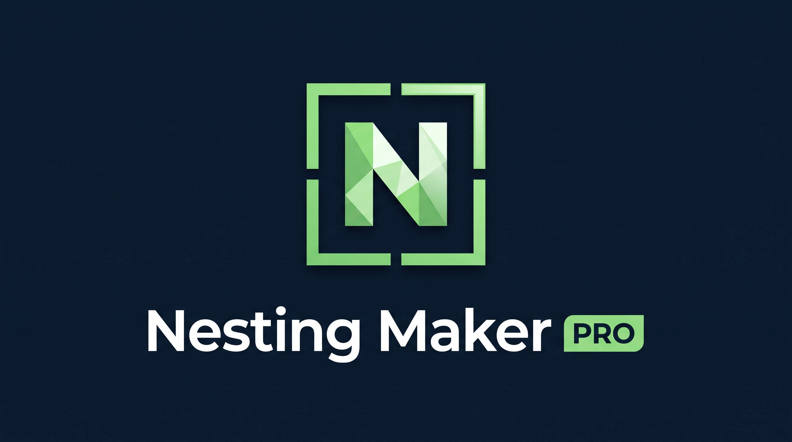
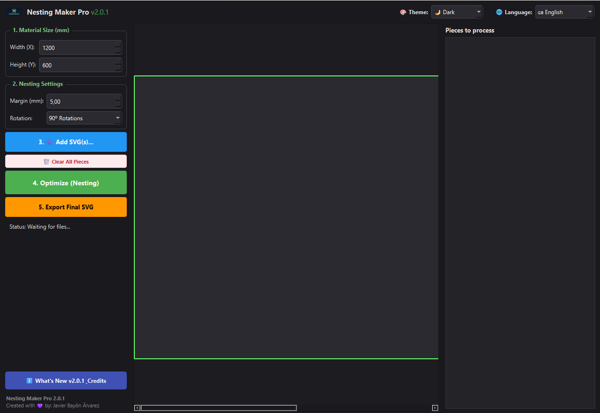
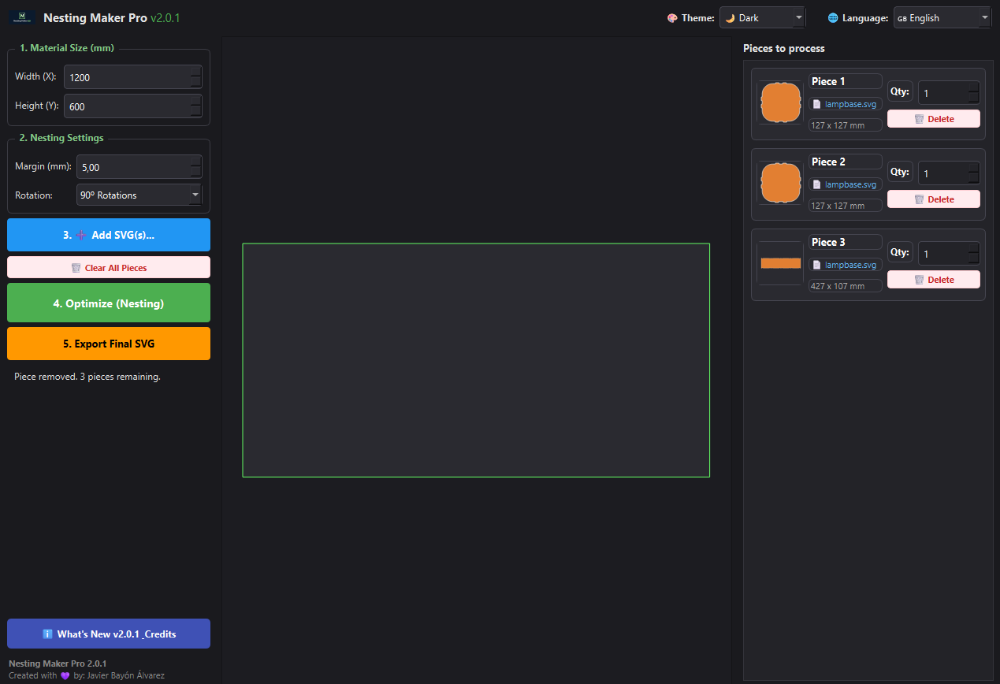
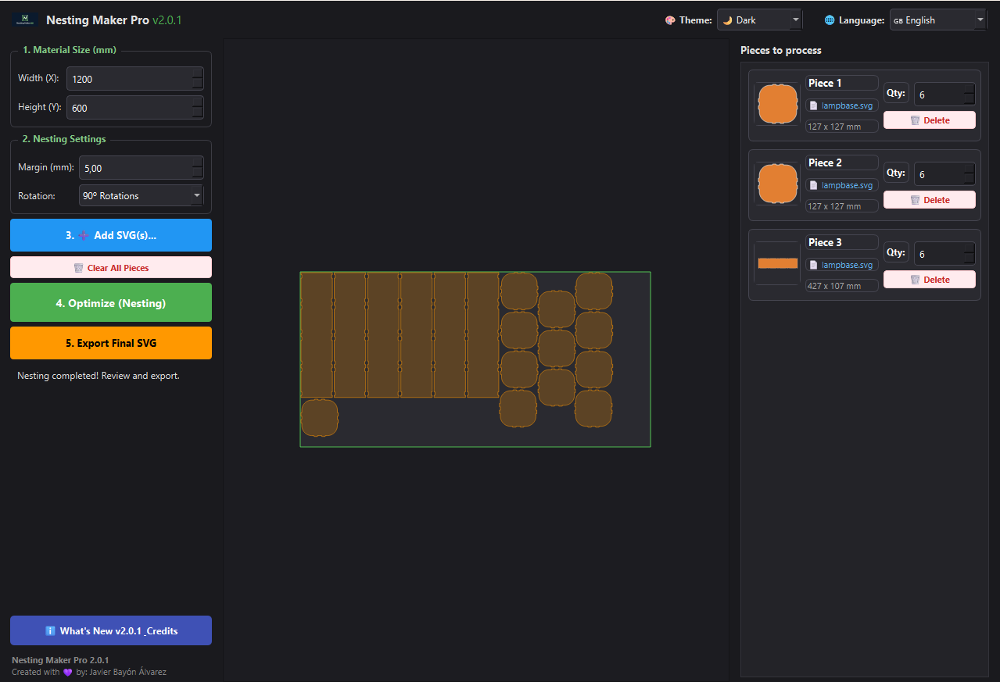

<p align="center">
  
</p>

<h1 align="center">Nesting Maker Pro 2.0.1</h1>

<p align="center">
  <b>High-Performance Offline 2D Irregular Nesting Engine for Laser Cutters & CNC Routers</b><br>
  <i>Created with 💜 by <b>Javier Bayón Álvarez</b></i>
</p>

<p align="center">
  
  
  
  
  
  
</p>

---

## 🌟 Overview

**Nesting Maker Pro 2.0.1** is a desktop application designed for makers, fabricators, and CNC/laser cutting workshops. It optimizes the arrangement of irregular 2D shapes onto raw material sheets to maximize material yield and minimize scrap.

Powered by a cutting-edge **discrete rasterization and Fast Fourier Transform (FFT) collision matrix**, it offers rapid, collision-free true-shape packing while remaining **100% desktop-based and offline**.

---

## 📸 Screenshots & Showcase

<p align="center">
  <b>1. Modern UI & Workspace (Dark Mode, Bilingual controls & sheet sizing)</b><br>
  
</p>
<br>

<p align="center">
  <b>2. Interactive Piece Management (Multi-file loading, thumbnails, quantities & individual deletion)</b><br>
  
</p>
<br>

<p align="center">
  <b>3. High-Density Nested Results (Optimized packing layout on raw material sheet)</b><br>
  
</p>

---

## 💡 The Power of Being 100% Offline (Why Desktop Beats the Cloud)

Unlike cloud-dependent web tools and online nesting portals, **Nesting Maker Pro is built from the ground up to operate completely offline**. Here is why this is a game-changer for digital fabrication:

### 1. 📶 Zero Internet Required (Workshop Resilience)
* Industrial workshops, basements, and maker spaces often suffer from weak or non-existent Wi-Fi connections.
* With Nesting Maker Pro, you can operate machines in disconnected facilities or on dedicated shop PCs without ever worrying about lost connections or browser crashes.

### 2. 🔒 Absolute Intellectual Property & Privacy Protection
* Cloud nesting requires uploading proprietary vector files, patented components, and client CAD data to third-party remote servers.
* With Nesting Maker Pro, **your files never leave your computer**. Your confidential drawings and client files remain strictly local and secure.

### 3. ⚡ Maximum Processing Power & Zero Queues
* No waiting in shared server queues or dealing with cloud CPU throttling during peak hours.
* The software harnesses the full local computing power of your multi-core CPU using vectorized NumPy and SciPy routines with zero latency.

### 4. 💸 No Subscriptions, No Tokens, No Expiring Credits
* Web services frequently charge per-job fees, monthly subscriptions, or limit the number of pieces you can calculate.
* Nesting Maker Pro is completely free, standalone, and perpetual: nest unlimited parts across unlimited sheets anytime.

---

## ⚙️ How It Works (Algorithmic Core)

### 🧩 Discrete Raster Grid + FFT Convolution
Traditional geometric nesting solvers rely on **No-Fit Polygons (NFP)**, which frequently freeze or fail when processing complex Bézier curves, splines, or self-intersecting loops. 
* Nesting Maker Pro converts polygons into high-resolution boolean raster matrices.
* Fast Fourier Transform (FFT) cross-correlations detect overlaps in milliseconds, making the engine **completely immune to geometric floating-point crashes**.

### ⭕ Intelligent Topology & Hole-Packing
* **Sub-path Hierarchy:** Automatically analyzes nested contours so that outer frames and inner holes stay rigidly grouped as a single entity.
* **Hole-Packing Efficiency:** Detects empty interior regions of hollow parts (such as rings or frames) and nests smaller pieces inside them, reclaiming wasted sheet area.

### 📂 Multi-Project Cumulative Workflow
* Load multiple distinct SVG files into a single job session.
* Identify which piece belongs to which design through color-coded source labels.
* Adjust piece quantities individually or discard specific parts with the **`🗑️ Delete`** button.

### 🎨 Themes & Bilingual Internationalization
* **Bilingual:** Switch between **🇪🇸 Spanish** and **🇬🇧 English** on the fly.
* **Dark / Light Modes:** Seamless theme switching to reduce eye strain in low-light workshop environments.
* **Middle-Mouse Pan & Zoom:** Effortless canvas navigation using the mouse wheel.

---

## 🚀 Installation & Downloads

### Option 1: Standalone Windows Installer (Recommended)
Download the pre-compiled installer:
* **`Instalador Nesting Maker Pro 2.0.1.exe`**
* Features a clean setup wizard that automatically configures the application and creates Desktop and Start Menu shortcuts.

### Option 2: Running from Source

#### Prerequisites
* Python 3.10 or higher
* Git

#### Setup
```bash
# 1. Clone the repository
git clone https://github.com/itsjbayon/nesting-maker-pro.git
cd nesting-maker-pro

# 2. Create and activate a virtual environment
python -m venv venv
# On Windows:
.\venv\Scripts\activate
# On Linux/macOS:
source venv/bin/activate

# 3. Install dependencies
pip install -r requirements.txt

# 4. Launch the application
python main.py
```

---

## 📖 Step-by-Step Usage Guide

1. **Define Sheet Dimensions:** Enter your raw sheet's width and height in millimeters.
2. **Configure Spacing (Margin):** Set the safety distance between parts based on your laser beam kerf or router bit diameter (e.g., `2.0 - 5.0 mm`).
3. **Choose Rotation Mode:**
   * *No Rotation (0º)*: Keeps original orientation (ideal for grain-sensitive materials like wood or brushed metal).
   * *90º Increments*: Recommended balance between high packing density and rapid calculation.
   * *Free Rotation*: Maximizes density by evaluating continuous angles.
4. **Add SVG Files:** Click **`3. ➕ Add SVG(s)...`** to load one or multiple vector files.
5. **Set Quantities:** Use the quantity spinbox for each part or remove unwanted parts.
6. **Optimize:** Click **`4. Optimize (Nesting)`**. The algorithm arranges parts in seconds.
7. **Export:** Click **`5. Export Final SVG`** to save a production-ready SVG compatible with **LightBurn**, LaserGRBL, RDWorks, and CNC CAM software.

---

## 🛠️ Project Structure

```
nesting-maker-pro/
├── main.py                     # PyQt6 GUI Application Entry Point
├── nesting_engine.py           # Bridge between Vector SVG & Raster Solver
├── installer.py                # Standalone GUI Setup Wizard
├── requirements.txt            # Python Dependencies
├── icon.ico                    # Windows Application Icon
├── LICENSE                     # MIT License
├── README.md                   # Documentation (English)
├── media/
│   ├── Logo.jpg                # Official Brand Logo
│   ├── Example1.png            # App UI & Part Loading Screenshot
│   ├── Example2.png            # Nested Layout Optimization Screenshot
│   └── Example3.png            # Advanced Topology & Hole-Packing Screenshot
└── raster_engine_v2/           # Mathematical Raster Nesting Core
    ├── __init__.py
    ├── engine.py               # RasterNestingEngine facade
    ├── packer.py               # BLF Bottom-Left-Fill Grid Packer
    ├── collision.py            # FFT Matrix Cross-Correlation
    ├── rasterizer.py           # Polygon to Binary Grid Rasterization
    └── geometry.py             # Shapely Polygon Sanitation & Safety Offsets
```

---

## 📜 License

This project is licensed under the **MIT License** - see the [LICENSE](LICENSE) file for details.

---

## 💜 Author & Acknowledgments

* **Created by:** [Javier Bayón Álvarez](https://github.com/itsjbayon)
* Dedicated to the open-source maker community, laser cutting enthusiasts, and CNC fabricators worldwide.
